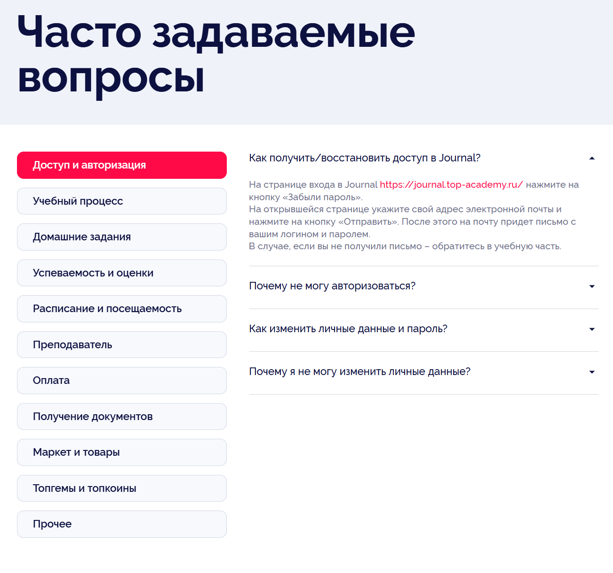

# FAQ Page for TOP Academy 🎓 📄


Адаптивная страница «Часто задаваемые вопросы» (FAQ) для образовательной платформы «Академия ТОП», разработанная в
составе студенческой команды.

## 🎯 Моя роль в проекте

- Верстка интерактивного блока аккордеона с табами (вопросы/ответы).
- Адаптация интерфейса под мобильные устройства (responsive design).

## ✨ Особенности реализации

1. **SEO-оптимизация**: Полная поддержка микроразметки `schema.org/FAQPage`, `Question` и `Answer`, что позволяет
   поисковым системам формировать расширенные сниппеты (Rich Snippets).
2. **UI/UX**: Реализован удобный таб-интерфейс с категориями вопросов и плавным раскрытием ответов (аккордеон).
3. **Производительность**: Асинхронная загрузка JS-скриптов (`defer`) и оптимизированные пути к статическим активам для
   ускорения First Contentful Paint (FCP).
4. **Кроссбраузерность**: Корректное отображение во всех современных браузерах благодаря использованию
   стандартизированных CSS-классов и сбросу стилей.

## 🚀 Демонстрация


*Интерактивный интерфейс с поддержкой микроразметки Schema.org*

## 🛠 Стек технологий

- **Разметка**: HTML5 (семантическая верстка)
- **Стилизация**: CSS3 (кастомная дизайн-система академии, адаптивная сетка)
- **Интерактивность**: Vanilla JavaScript (jQuery для легаси-совместимости), Swiper.js (для слайдера категорий на
  мобильных)
- **Инструменты**: Git, Figma (для сверки с макетом)

## 🚀 Структура проекта

```text
├── index.html                # Основная страница с микроразметкой
├── assets/
│   ├── template/v5/new2/css/ # Стили проекта
│   ├── template/v5/new2/js/  # Скрипты (global, faq logic)
│   └── images/               # Иконки и медиафайлы
```

## 💡 Чему я научился, работая над этим проектом

- Работать в команде с общей кодовой базой и дизайн-системой.
- Понимать важность SEO не только на уровне текста, но и на уровне HTML-разметки.
- Писать чистый, поддерживаемый код, который легко читать другим разработчикам.